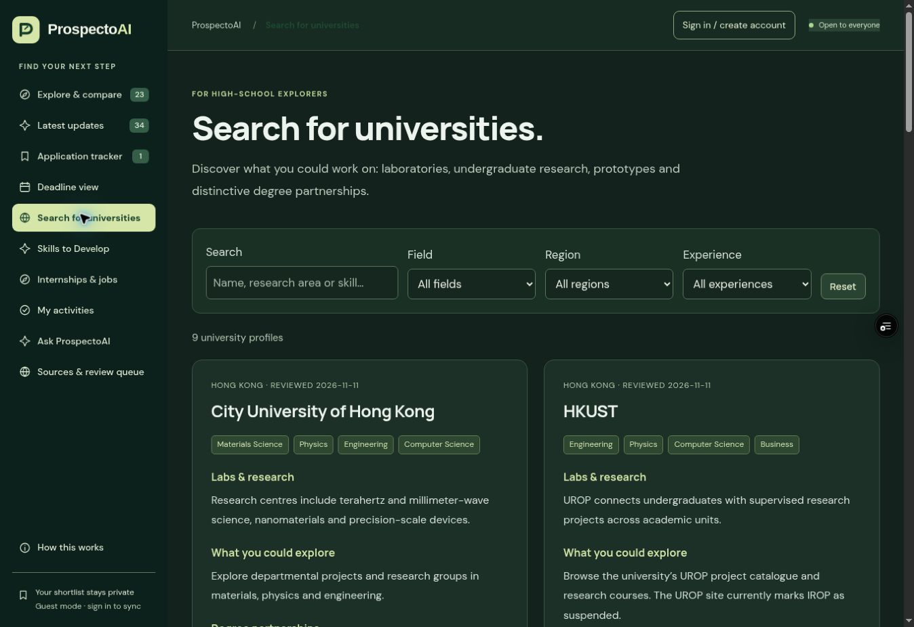

# ProspectoAI

A place to explore education and career possibilities, build useful skills and keep track of the next step.

[Open the website](https://opportunity-explorer-ruddy.vercel.app/)



## Explore

- Research programmes, scholarships, hackathons and olympiads, with filters, comparisons and deadline reminders.
- **Search for Universities**: laboratories, undergraduate research, prototyping and distinctive degree partnerships. No score thresholds or admission predictions.
- **Skills to Develop**: six career paths with technical and transferable skills, tools, projects and verified course links.
- **Internships and Jobs**: official career sources and individual postings. A source directory is clearly distinguished from a vacancy; missing deadlines are not guessed.
- An optional account workspace with a saved application tracker, profile and private activities. Activities support notes, dates, categories, priority, progress, filtering and sorting.
- A source-grounded assistant for discovery and development plans. Guest catalog search is separate from AI generation.

The initial expanded collection contains 23 opportunities, 9 university profiles, 6 skill paths, 11 courses and 9 career sources/postings. Each retains its source and review date. Prices, openings, facilities access and programme conditions can change.

## Run locally

Requires Node.js 24 and npm.

```bash
npm ci --ignore-scripts
npm run build
npm run dev
```

Open `http://127.0.0.1:4173`. Local configuration and chat handlers are available; without AI configuration, the assistant returns clearly labelled catalog search. The feed uses its saved fallback when live storage is unavailable.

```bash
npm run check
npm run format:check
npm audit
npm run seed:export
```

Set environment variables in your hosting dashboard or an untracked local file. A plain Node process does not automatically load `.env.local`; export the variables before starting it, or use Node's `--env-file` option. Never commit credentials.

## Source and build

| Path                                                | Purpose                                                              |
| --------------------------------------------------- | -------------------------------------------------------------------- |
| `dist/index.html`, `dist/app.js`, `dist/styles.css` | Existing explorer and tracker                                        |
| `src/platform.js`, `dist/platform.css`              | Accounts, skills, universities, careers, activities and assistant UI |
| `dist/opportunities.json`, `dist/resources.json`    | Researched source catalogs                                           |
| `dist/assets/`                                      | ProspectoAI SVG mark and dark/light wordmarks                        |
| `api/`                                              | Configuration, chat, feeds, review report and scheduled refresh      |
| `lib/`                                              | Retrieval, source auditing, feed parsing, storage and caching        |
| `supabase/migrations/`                              | Reproducible schema and ownership policies                           |
| `supabase/seed.sql`                                 | Generated, source-backed public content; no users or secrets         |
| `tests/`                                            | Validation, tracker, calendar, assistant, feeds and renewal checks   |
| `docs/`                                             | Skills guide, recovery notes and review workflow                     |

`npm run build` generates the catalog scripts and bundles the Supabase client from pinned packages. It rejects missing frontend assets. Generated `dist/platform.js` and `dist/resource-data.js` are ignored in Git; the source and lockfile reproduce them.

## Supabase

Create a project, then apply the migrations in order. Run the idempotent `supabase/seed.sql` after reviewing it. Public resources are readable, while `profiles`, `trackers` and `activities` are restricted to their owners using `auth.uid()` in every policy. No service-role key is used in the browser or required by the application.

The account client supports email/password registration, login, logout, session persistence and reset-password links. Before opening registration publicly, configure these owner settings:

1. **Authentication → URL Configuration**: set the Site URL to the production origin. Allow its root and password-recovery redirects.
2. **Authentication → Email / SMTP**: configure delivery for public users. Supabase's default sender is restricted and is not a production email service.
3. Confirm email signup is enabled; test confirmation and recovery using an account you own.

Do not disable email confirmation as a workaround for delivery failures. The UI surfaces delivery and session errors without pretending a registration succeeded.

## Environment variables

| Variable                   | Visibility           | Purpose                                                       |
| -------------------------- | -------------------- | ------------------------------------------------------------- |
| `SUPABASE_URL`             | Public configuration | Project API origin                                            |
| `SUPABASE_PUBLISHABLE_KEY` | Public configuration | Browser-safe key; RLS enforces ownership                      |
| `BLOB_READ_WRITE_TOKEN`    | Server secret        | Private feed and source-review snapshots                      |
| `CRON_SECRET`              | Server secret        | Scheduled refresh authorization                               |
| `AI_GATEWAY_MODEL`         | Server configuration | Exact `provider/model` ID from the gateway catalog            |
| `AI_GATEWAY_API_KEY`       | Server secret        | Gateway authentication when deployment OIDC is not configured |

The public config endpoint returns only the project URL, publishable key and capability flag. It never returns AI, cron, storage or service-role secrets.

## AI interface and limits

`POST /api/chat` validates input, retrieves matching researched records and returns attributed references with review dates. It uses the provider-independent Vercel AI SDK and the configured gateway model. Set `AI_GATEWAY_API_KEY` securely, or use deployment OIDC only after the project owner approves that authentication setup. A ChatGPT subscription is not used by the website.

AI calls require a verified Supabase session. The database enforces 10 requests per user per day and 200 requests site-wide per day. Inputs, history and output length are bounded. A failed provider, missing configuration or exhausted allowance returns clearly labelled catalog search. A personalized plan asks for missing stage, field, time and goals first.

The model has no tools to execute commands, modify the database, submit applications or send messages. Imported content is data, and model text is rendered as text rather than HTML. Chat history stays in the tab, is cleared on account changes, and is not stored by the app unless a user explicitly saves a recommendation as an activity. AI messages and selected context are transmitted to the model provider; provider retention policies still apply.

The quota RPC is an intentionally privileged, narrowly scoped function: it checks the current authenticated user, uses a fixed search path and serializes counter updates. Anonymous execution and direct counter-table access are denied. Security advisors may flag authenticated execution for review; granting arbitrary clients counter-table write access would defeat the limit.

## Weekly renewal

Vercel Cron runs Monday at 00:00 UTC / 08:00 Hong Kong. It collects attributed Telegram/RSS leads and checks the fixed provider source list with bounded HEAD requests. Failed checks retain previous records. Changed headers, stale provider facts and broken links enter a read-only review report. A separate Supabase pg_cron job marks known expired public opportunities without deleting saved user data.

The process does not automatically rewrite university facilities, course prices or job eligibility from scraped text. Those facts enter the repository review workflow before publication. See [maintenance workflow](docs/maintenance.md).

## Deployment

Import the repository root into Vercel with framework **Other**. Use `npm run build`, `npm ci --ignore-scripts --no-fund --no-audit`, output `dist` and Node.js 24. Include the entire repository source; publishing only the feed functions causes the missing-homepage failure described in [recovery notes](docs/recovery.md).

Configure the environment variables, apply the database migrations and seed, then deploy the tested GitHub revision. Verify the production origin, assets, `/api/config`, `/api/discover`, `/api/renewal`, guest assistant and signed-in user flows. Vercel READY is not sufficient proof.

GitHub is the source of truth. Keep provider fact changes, schema changes and configuration instructions in the repository. Use a PR and passing checks before merging a release.

## Privacy and costs

Guest tracker data remains in the browser. Signed-in trackers, profiles and activities are private to the user. Guest data is imported only on request. Shared links and calendar exports omit private notes. A tracker backup contains notes and should be kept private.

Supabase, Vercel functions, Blob storage, email delivery and AI have separate quotas and may incur charges. No paid tier or billing commitment is included in source configuration. AI request caps bound volume; monitor provider prices, account budgets and hosting usage before growing traffic. Expensive model changes require reviewing those limits.

Created by **Yermukhamed Tuktibay**.
